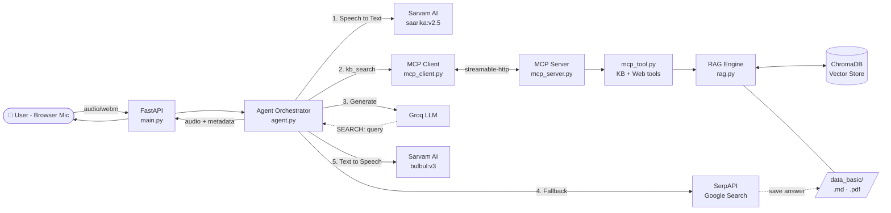

<div align="center">

#  RxE Voice AI

### Multilingual Voice Assistant for Healthcare & Medical E-Commerce

*Speak in your language. Get a spoken answer in seconds — grounded in your own medical knowledge base, with a live web fallback.*


</div>


## Overview

**RxE Voice AI** is a low-latency, multilingual, voice-first assistant designed for healthcare and medical e-commerce support, covering medicines, lab tests, medical devices, orders, returns, and delivery-related queries.

Users can simply speak in any of **11 supported Indian languages**, and the assistant understands their queries and responds with **natural, same-language audio responses.**

Powered by **Retrieval-Augmented Generation (RAG)**, Groq, Sarvam AI, ChromaDB, SerpAPI, and the **Model Context Protocol (MCP)**, the system grounds its responses in a curated knowledge base containing Markdown and PDF documents rather than relying solely on an LLM's internal knowledge.

When the knowledge base cannot provide a sufficient answer, the agent automatically falls back to **live web search using SerpAPI,** processes the retrieved information, generates a relevant response, and saves the search results back into the knowledge base for future retrieval.

The complete voice interaction **pipeline — Speech → Text → Retrieval → LLM → Speech — is designed around a ~2-second core latency target,** with per-request latency, token usage, and estimated API costs (₹) tracked for performance and cost monitoring.

Important: RxE Voice AI is an informational healthcare support assistant, not a substitute for qualified medical professionals. It does not replace professional medical diagnosis, prescriptions, or emergency medical care.


##  Key Features

| Feature | Description |
|---|---|
|  **Voice-first, multilingual** | Auto language detection and replies in the user's language across 11 Indian languages (Hindi, English, Bengali, Gujarati, Kannada, Malayalam, Marathi, Odia, Punjabi, Tamil, Telugu). |
|  **Grounded answers (RAG)** | Semantic search over a local knowledge base using multilingual embeddings and ChromaDB; the LLM is instructed to answer *only* from retrieved context. |
|  **Smart web fallback** | If the KB has no answer, the LLM emits a `SEARCH:` directive and the agent queries Google through SerpAPI, then answers from the web results. |
|  **Self-growing knowledge base** | Web answers are persisted to `serpapi.md` and indexed into the vector DB, so repeated questions are served from the KB next time. |
|  **MCP-powered tools** | Retrieval, indexing and web search are exposed as **Model Context Protocol** tools, with automatic in-process fallback if the MCP server is unavailable. |
|  **Latency-optimised** | Async everywhere, HTTP/2 connection pooling, parallel TTS chunk synthesis, and startup warm-up for the LLM, vector store and TTS provider. |
|  **Built-in cost metering** | Every response includes a per-stage cost breakdown in INR (STT, LLM, TTS, web search, infra). |
|  **Healthcare guardrails** | Short, speech-friendly replies; no guessing of conditions or prescriptions; emergency routing to a support helpline. |
|  **Incremental indexing** | SHA-256 manifest-based sync — only new or changed files are re-embedded; deleted files are purged automatically. |
|  **Production-style observability** | Request IDs, structured metrics, slow-stage warnings and a pipeline latency summary on every call. |


##  System Architecture



> **Resilience:** if the MCP server cannot be reached at startup, the app logs the failure and transparently switches to **in-process mode** — the same tools run inside the FastAPI process.


## Request Pipeline

Each call to `POST /api/voice` runs the following stages (see `agent.run_voice`):

1. **Speech-to-Text** — Audio is sent to Sarvam `saarika` with automatic language detection (`language_code=unknown`). Unsupported languages fall back to Hindi.
2. **Retrieval** — The transcript is used as the query for `kb_search` (via MCP or in-process). The top-K chunks (default 3, capped at 1800 characters) become the LLM context.
3. **LLM (KB mode)** — Groq answers using **only** the retrieved context, in the user's language, in at most a couple of short sentences.
4. **Web fallback (conditional)** — If the context can't answer the question, the LLM returns exactly `SEARCH: <english query>`. The agent then:
   - queries SerpAPI (answer box → knowledge graph → top organic snippets),
   - asks the LLM to answer *only* from the web results (with a "general medical information" note),
   - saves the Q&A into `data_basic/serpapi.md` and indexes it in the background.
5. **Speech cleanup & language detection** — Markdown and emoji are stripped; the reply's script is inspected to choose the correct TTS language.
6. **Text-to-Speech** — Sarvam `bulbul` synthesises audio; long replies are split on sentence boundaries and synthesised **in parallel**.
7. **Metrics** — Latency (STT / retrieval / LLM / web / TTS), token usage and ₹ cost are logged and returned.

**Response `path` values**

| `path` | Meaning |
|---|---|
| `kb` | Answered from the local knowledge base |
| `web` | Answered from live web search results |
| `web_failed` | KB had no answer and web search returned nothing → safe fallback message |
| `web_llm_failed` | Web results found but LLM reply was invalid → safe fallback message |
| `llm_empty` | LLM returned an empty reply → safe fallback message |
| `empty` | Empty transcript; LLM/TTS skipped |


##  Tech Stack

| Layer | Technology |
|---|---|
| **API / Server** | FastAPI, Uvicorn, python-multipart |
| **Speech-to-Text** | [Sarvam AI](https://www.sarvam.ai/) — `saarika:v2.5` |
| **Text-to-Speech** | [Sarvam AI](https://www.sarvam.ai/) — `bulbul:v3` (speaker: `shubh`) |
| **LLM Inference** | [Groq](https://groq.com/) (configurable via `GROQ_MODEL`) |
| **Web Search** | [SerpAPI](https://serpapi.com/) (Google engine, `gl=in`) |
| **Embeddings** | FastEmbed — `paraphrase-multilingual-MiniLM-L12-v2` |
| **Vector Store** | ChromaDB (cosine similarity) via `langchain-chroma` |
| **RAG Tooling** | LangChain (text splitters, document loaders), PyPDF |
| **Tool Protocol** | Model Context Protocol (`mcp`), streamable-HTTP transport |
| **HTTP Client** | `httpx` with HTTP/2 and keep-alive pooling |
| **Packaging** | `uv` / `pyproject.toml`, Python ≥ 3.12 |


##  Project Structure

```text
RxE-Voice-AI/
├── main.py            # FastAPI app: lifespan, middleware, REST endpoints, session store
├── agent.py           # Orchestrator: STT → RAG → LLM → (web) → TTS, prompts, cost & latency
├── voice.py           # Sarvam STT/TTS clients, Groq client, language map, cost helpers
├── rag.py             # Chunking, embeddings, ChromaDB, incremental indexing, search
├── mcp_server.py      # MCP server exposing KB & web-search tools
├── mcp_client.py      # MCP client with timeouts, retry and auto-reconnect
├── mcp_tool.py        # Tool implementations: kb_search, kb_list_sources, kb_reindex, web_search_save
├── logger.py          # Logging, request-ID context, metrics & Timer utilities
├── cost.ipynb         # Notebook for cost analysis
├── data_basic/        # Knowledge base source files (.md / .pdf)
├── static/            # Web UI (index.html) served at "/"
├── .env.example       # Environment variable template
├── requirements.txt   # Python dependencies
├── pyproject.toml     # Project metadata (uv)
└── uv.lock            # Locked dependency versions
```


## Getting Started

### Prerequisites

- **Python 3.12+**
- API keys for:
  - [Groq](https://console.groq.com/) — LLM
  - [Sarvam AI](https://www.sarvam.ai/) — STT & TTS
  - [SerpAPI](https://serpapi.com/) — web-search fallback
- A modern browser with microphone access (for the web UI)

### 1. Clone the repository

```bash
git clone https://github.com/krishkydv77/RxE-Voice-AI.git
cd RxE-Voice-AI
```

### 2. Install dependencies

**Using `uv` (recommended):**

```bash
uv sync
```

**Or using `pip`:**

```bash
python -m venv .venv
source .venv/bin/activate        # Windows: .venv\Scripts\activate
pip install -r requirements.txt
```

### 3. Configure environment

```bash
cp .env.example .env
```

Open `.env` and fill in the required keys:

```env
GROQ_API_KEY=your_groq_key
SARVAM_API_KEY=your_sarvam_key
SERPAPI_API_KEY=your_serpapi_key
```

### 4. Add your knowledge base

Drop `.md` or `.pdf` files into `data_basic/`. They are indexed automatically at startup (unchanged files are skipped).

### 5. Run the application

**Option A — MCP mode (default, `USE_MCP=1`)** The FastAPI application connects to the
    separate MCP server and invokes its registered tools.

Start the MCP server first, then the API:

```bash
# Terminal 1 — MCP tool server
python mcp_server.py --transport streamable-http --host 127.0.0.1 --port 8001

# Terminal 2 — FastAPI app
python main.py And uvicorn main:app --reload --port 8000
```

**Option B — In-process mode (`USE_MCP=0`)** The application calls the Python
    tool functions directly without a separate MCP server.

```bash
USE_MCP=0 python main.py
```

Then open **http://localhost:8000**, allow microphone access, and start speaking.

>  If `USE_MCP=1` but the MCP server isn't running, the app logs an error and automatically falls back to in-process mode.

### Optional: build / inspect the index from the CLI

```bash
python rag.py                          # sync new/changed files
python rag.py --rebuild                # purge and rebuild everything
python rag.py --query "return policy"  # test retrieval
```

---

##  Configuration

All settings are read from environment variables (see `.env.example`).

### API keys *(required)*

| Variable | Description |
|---|---|
| `GROQ_API_KEY` | Groq API key for LLM inference |
| `SARVAM_API_KEY` | Sarvam AI key for STT and TTS |
| `SERPAPI_API_KEY` | SerpAPI key for web fallback (`SERPAPI_KEY` also accepted) |

### Models

| Variable | Default | Description |
|---|---|---|
| `GROQ_MODEL` | `qwen/qwen3.8-27b` | Groq chat model |
| `SARVAM_STT_MODEL` | `saarika:v2.5` | Speech-to-text model |
| `SARVAM_TTS_MODEL` | `bulbul:v3` | Text-to-speech model |
| `SARVAM_TTS_SPEAKER` | `shubh` | TTS voice |

### RAG

| Variable | Default | Description |
|---|---|---|
| `DATA_DIR` | `data_basic` | Knowledge-base folder |
| `VECTOR_DIR` | `vectordb` | ChromaDB persistence folder |
| `EMBED_MODEL` | `sentence-transformers/paraphrase-multilingual-MiniLM-L12-v2` | Multilingual embedding model |
| `CHUNK_SIZE` / `CHUNK_OVERLAP` | `500` / `80` | Chunking parameters |
| `TOP_K` | `3` | Chunks retrieved per query |

### Assistant behaviour

| Variable | Default | Description |
|---|---|---|
| `REPLY_MAX_WORDS` | `15` | Max words per spoken reply (enforced via prompt) |
| `LLM_MAX_TOKENS` | `160` | LLM output token cap |
| `LLM_REASONING_EFFORT` | `low` | Reasoning effort for `gpt-oss` models only |
| `SUPPORT_HELPLINE` | `1800-123-4567` | Number the assistant gives for emergencies / critical billing issues |
| `CORE_TARGET_MS` | `2000` | STT + LLM + TTS latency budget |
| `SERPAPI_TIMEOUT` | `5` | Web-search timeout (seconds) |
| `SLOW_STT_MS` / `SLOW_LLM_MS` / `SLOW_TTS_MS` | `2000` / `2000` / `3000` | Slow-stage warning thresholds |

### MCP, logging & server

| Variable | Default | Description |
|---|---|---|
| `USE_MCP` | `1` | `1` = tools via MCP server, `0` = in-process |
| `MCP_SERVER_URL` | `http://127.0.0.1:8001/mcp` | MCP endpoint |
| `MCP_CONNECT_TIMEOUT` / `MCP_CALL_TIMEOUT` | `5` / `20` | MCP timeouts (seconds) |
| `LOG_DIR` / `LOG_LEVEL` | `logs` / `INFO` | Logging output |
| `HOST` / `PORT` | `0.0.0.0` / `8000` | Server bind address |

---

##  API Reference

Base URL: `http://localhost:8000`

### `POST /api/voice`

Run the full voice pipeline.

**Request** — `multipart/form-data`

| Field | Type | Description |
|---|---|---|
| `audio` | file | Recorded audio (e.g. `audio/webm`). Max **10 MB**. |
| `session_id` | string | Conversation ID (default: `default`). The last 4 messages are used as context. |

**Example**

```bash
curl -X POST http://localhost:8000/api/voice \
  -F "audio=@question.webm;type=audio/webm" \
  -F "session_id=user-123"
```

**Response**

```jsonc
{
  "transcript": "मेरा ऑर्डर कब तक पहुंचेगा?",
  "reply": "आपका ऑर्डर दो से तीन दिन में पहुंच जाएगा।",
  "language": "hi-IN",
  "audios": ["<base64-encoded WAV chunk>", "..."],
  "path": "kb",                       // kb | web | web_failed | ...
  "sources": ["delivery_policy.md"],
  "metadata": {
    "top_score": 0.71,
    "via_mcp": true,
    "stt_ms": 420, "retrieval_ms": 38, "llm_ms": 310, "web_ms": 0, "tts_ms": 560,
    "core_ms": 1290, "total_ms": 1385,
    "stt_cost_inr": 0.0, "llm_cost_inr": 0.0, "tts_cost_inr": 0.0,
    "web_cost_inr": 0.0, "other_infra_cost_inr": 0.05,
    "total_cost_inr": 0.0
  }
}
```

> Example values are illustrative.

**Errors:** `400` empty audio · `413` audio larger than 10 MB · `502` upstream (STT / LLM / TTS) failure.

### Other endpoints

| Method | Endpoint | Description |
|---|---|---|
| `GET` | `/` | Serves the web UI |
| `GET` | `/api/health` | Status, tool mode (`mcp` / `in-process`), indexed sources/chunks, active sessions |
| `POST` | `/api/reindex?force=false` | Re-sync the knowledge base (`force=true` re-embeds everything) |
| `DELETE` | `/api/session/{session_id}` | Clear a conversation's history |

Every response carries an `X-Request-ID` header for log correlation. Sessions are held in memory with LRU eviction (max **200**).


##  Knowledge Base (RAG)

- **Supported formats:** Markdown (`.md`, `.markdown`) and PDF.
- **Markdown chunking:** header-aware splitting (`#`, `##`, `###`) followed by recursive character splitting. Each chunk is prefixed with its section path (e.g. `[Returns > Medicines]`) for better retrieval.
- **Script-aware separators:** includes the Devanagari danda (`।`), so Hindi text is split at natural sentence boundaries.
- **PDF chunking:** page-aware, with page numbers stored as metadata.
- **Incremental sync:** a `manifest.json` stores each file's SHA-256 hash; only new or modified files are re-embedded, and chunks of deleted files are purged.
- **Self-learning:** answers obtained from the web are appended to `data_basic/serpapi.md` (de-duplicated by a hash of the normalised question) and embedded immediately.
- **Similarity:** cosine distance; scores are reported as `1 − distance`.

**Tip:** structure your documents with clear headings (`## Return Policy`, `## Delivery Timelines`, …) — it directly improves retrieval quality.

---

##  MCP Tools

`mcp_server.py` registers four tools (server name: `healthcare-kb`):

| Tool | Purpose |
|---|---|
| `kb_search(query, top_k=3)` | Semantic search over the healthcare knowledge base |
| `kb_list_sources()` | List indexed files, chunk counts and index timestamps |
| `kb_reindex(force=False)` | Index new/updated Markdown & PDF files |
| `web_search_save(question, search_query)` | Web search via SerpAPI; saves the answer back to the KB in the background |

The MCP client (`mcp_client.py`) adds a connect timeout, a per-call timeout, and a **retry-with-reconnect** on timeouts or connection errors. The server also supports `stdio` and `sse` transports:

```bash
python mcp_server.py --transport stdio
```

---

## Performance & Cost Tracking

**Latency target:** `STT + LLM + TTS ≤ CORE_TARGET_MS` (default **2000 ms**). Each request logs a summary and flags `OK` or `OVER TARGET`:

```text
LATENCY SUMMARY | tools=MCP path=kb | STT=420 + LLM=310 + TTS=560 = CORE 1290 ms (target 2000) [OK] | ...
```

**Optimisations in place**

- Fully async pipeline (`asyncio`) with a shared HTTP/2 client and keep-alive pool
- Parallel TTS synthesis for multi-sentence replies
- Startup **warm-up** of the vector store, Groq and Sarvam connections
- Lazy-loaded embedding model and vector store
- Strict reply limits (short answers = faster LLM + TTS)
- Background (non-blocking) saving of web answers

**Cost model (estimates, in ₹)**

| Component | Basis |
|---|---|
| STT | ₹0.49 per audio minute (duration estimated from file size) |
| TTS | ₹3.00 per 1,000 characters |
| LLM | Groq per-token pricing, converted at ~₹83/USD |
| Web search | Flat ₹0.40 per web-fallback request |
| Infra | Flat ₹0.05 per request |

> Costs are **estimates** computed in code for monitoring purposes; check provider dashboards for billing-accurate numbers. See `cost.ipynb` for deeper analysis.


##  Safety & Compliance

The system prompt enforces healthcare-appropriate behaviour:

- **No speculation** — does not guess medical conditions or prescriptions without data.
- **Grounded facts** — product, prescription, return, delivery and order answers come only from the retrieved context.
- **Emergency routing** — emergencies, severe symptoms and critical billing issues direct the user to the support helpline (`SUPPORT_HELPLINE`).
- **Scoped assistant** — politely declines unrelated queries; small talk redirects to medicines, lab tests, devices or orders.
- **Transparency** — web-sourced medical answers are marked as *general medical information*.
- **Safe fallbacks** — if no reliable answer can be produced, the assistant says so and refers the user to healthcare support (in Hindi or English).
- **Speech-safe output** — no markdown, emoji or symbols in replies.


##  Logging & Observability

- Console + file logging under `LOG_DIR` (MCP server logs to `logs/mcp/`)
- Unique **request ID** per HTTP request, attached to every log line and returned as `X-Request-ID`
- Structured metrics (`log_metric`) for `stt`, `llm`, `tts`, `rag_search`, `rag_sync`, `serpapi`, `mcp_call`, `pipeline` and `request`
- Automatic warnings for slow STT/LLM/TTS stages and for truncated LLM output (`finish_reason=length`)
- Startup config dump and missing-API-key detection


##  Troubleshooting

| Symptom | Likely cause / fix |
|---|---|
| `ENV missing \| ... is not set` at startup | Add the key to `.env` and restart |
| `MCP server not found -> switching to in-process mode` | Start `mcp_server.py` first, or set `USE_MCP=0` |
| Empty answers / "No results found" | Add files to `data_basic/` and call `POST /api/reindex?force=true` |
| `502` from `/api/voice` | Check provider keys/quota (Sarvam, Groq) in the logs |
| Replies always fall back to the default message | KB lacks the topic *and* web search failed — verify `SERPAPI_API_KEY` |
| First request is slow | Embedding model downloads on first use; subsequent calls are warm |
| Microphone not working in browser | Use `localhost` or HTTPS — browsers block mic access on insecure origins |


##  Disclaimer

RxE Voice AI provides **general informational assistance only** and is **not a substitute for professional medical advice, diagnosis or treatment**. Always consult a qualified healthcare professional for medical decisions. In an emergency, contact your local emergency number immediately.

## Author
- **GitHub:** @krishkydv77
- **LinkedIn:** krishan-kumar7

If you find this project useful, please consider giving it a ⭐ on GitHub!
